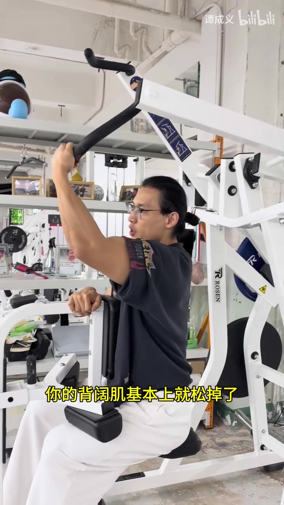
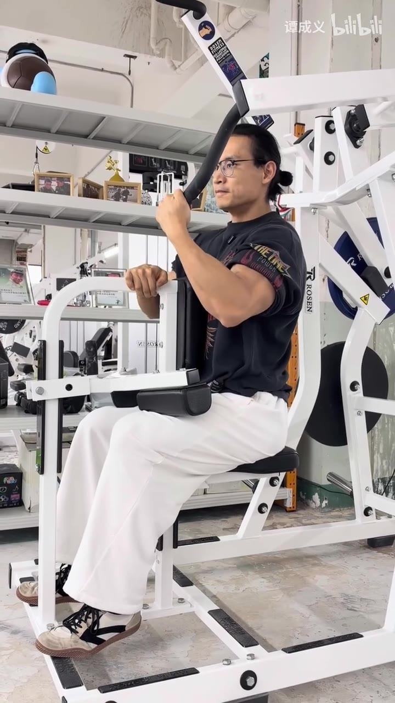
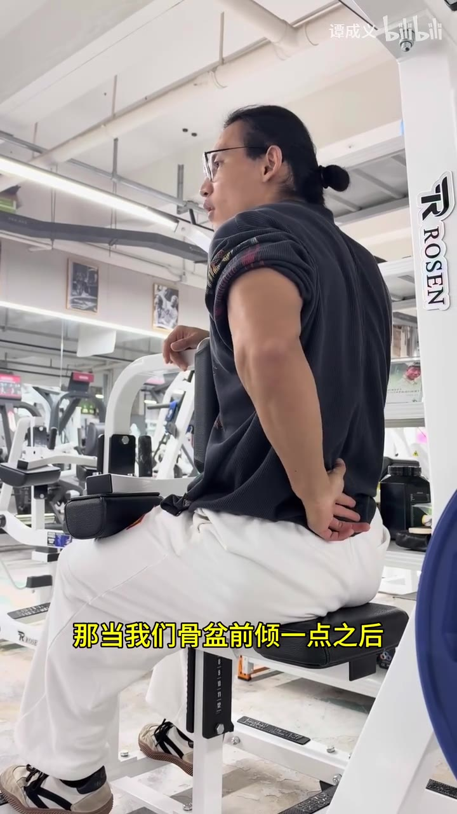
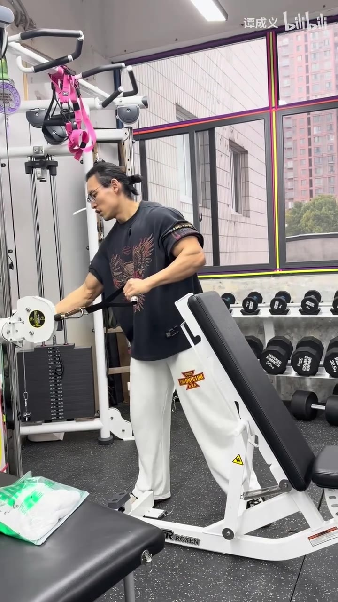

# 单手下拉：手肘先向下，再向后

> 来源：B站 · 谭成义（B站） · [BV1aexh6rErc](https://www.bilibili.com/video/BV1aexh6rErc) · 2026-11-02 11:04:25（北京时间） · 16 分 27 秒
> 依据：原片 + FunASR 转写（279 段 / 5652 字 / 344 字每分）+ 39 帧中实读 4 帧

**构成：约 80% 博主口播与动作演示（§1–§6），约 20% 外部对照（§7）。**

## 〇、来源与素材摘要

| 项目 | 值 | 口径 |
|---|---|---|
| 转写段数 | 279 段 | FunASR paraformer-zh |
| 转写字数 | 5652 字 | 去标点口径 |
| 口播密度 | 344 字每分 | 5652 ÷ 16.44 分钟 |
| 实读帧数 | 4 帧 | 4:40 / 7:10 / 9:30 / 12:30 |
| 机位 | 固定正面 + 侧面 | 能确认握法、手肘、躯干，不足以确认站距与脚尖 |
| 证据分布 | 原片 10 · 支持 2 · 质疑 2 · 权威数据 0 · 未找到 3 | 与 frontmatter 一致 |

## 一句话结论

这台分动式单手下拉是背阔肌的“王牌”器械之一，动作核心不是往后拉，而是手肘先向下、再向后，让肩胛下沉、背阔肌收紧[^v3]。

---

## 一、动作定位

| 模式 / 变式 | 关键区别 | 主要练哪 | 他的评价 | 原片 |
|---|---|---|---|---|
| 分动式单手下拉 | 单侧、固定轨迹、可加支撑 | 背阔肌，行程长 | 首选，可作主项 | [^v1] |
| 绳索高位下拉 | 自由轨迹，行程较短 | 背阔肌，偏上背 | 平替，行程短一点 | — |
| 绳索低位划船 | 滑轮放低，变成水平拉 | 下背阔更多 | 平替，偏划船模式 | [^v12] |

他的判断逻辑：器械和绳索不是谁更高级，而是**线的方向不同**；滑轮越低，动作越像划船[^v12]。

## 二、握法 · 站位 · 关节角度表

| 部位 | 他的要求 | 原片 | 画面能否确认 | 外部核对 |
|---|---|---|---|---|
| 握法 | 偏反手，但不是完全反手；半握 | [^v2] | 能 | 见 §7 |
| 握距 / 把手 | 把手微微外走，避免小臂旋后受限 | — | 能 | 见 §7 |
| 手肘 | 稍微向内收，不要往外顶 | [^v3] | 能 | 见 §7 |
| 手腕 | 往里扣，让手肘的力向下 | — | 能 | 见 §7 |
| 支撑腿 | 怎么稳怎么来，左右腿在前都可以 | [^v5] | 部分能 | 见 §7 |
| 骨盆 | 微微前倾，但不要顶腰 | [^v10] | 能 | 见 §7 |

这四条握法要求是同一个目的：让手肘能向下走。偏反手和把手外走，是为了绕开小臂旋后受限；半握，是为了不让他大拇指发力把力带向外侧；手腕内扣，则是把“往后拉”改成“往下压”。四条里只要有一条没做到，背阔肌的受力就会变差。以上是教练经验；外部证据只能说明“握法会影响肌肉活动”，不能证明这套握法对所有人最优。如果手腕或小臂在偏反手位不舒服，优先调整把手角度，不要硬扛。

## 三、动作分解表

| 阶段 | 他的要求 | 原片 | 画面确认 |
|---|---|---|---|
| 起始位 | 上放不要太高，手肘保留一点角度，背阔肌保持张力 | [^v6] | 4:40 帧：手肘未完全伸直 |
| 离心 / 下放 | 放的时候吸气，背预先发力，不要完全松掉 | [^v8] | 可确认躯干直立 |
| 底部 / 终点 | 手肘向下、肩胛下沉，背阔肌收紧 | [^v3] | 7:10 帧：手肘向下，躯干基本直立 |
| 向心 | 先向下再向后，向心收紧后再保证离心 | — | 可确认手肘轨迹 |
| 错误示范 | 只往后拉、不往下走，肩胛翻起，下背阔收不紧 | — | 口播描述，画面为演示 |

## 四、口令清单

- 「手肘的力是往下往后，而不是往后往下；顺序一定是先向下再向后。」（03:59–04:28）[^v3]
- 「你放得太高之后，你的背阔肌基本上就松掉了。」（04:28–05:00）[^v6]
- 「器械有的时候就是帮你设计出来，就是好用一点。」（13:58–14:27）[^v12]

## 五、常见错误

| 错误 | 后果 | 原片 |
|---|---|---|
| 手肘只往后、不往下 | 肩胛翻起，下背阔收不紧 | [^v3] |
| 手腕不内扣 | 背的受力变差 | — |
| 上放太高 | 背阔肌松掉，手臂和肩膀先接管 | [^v6] |
| 重量太重只做半程 | 向心没有收紧 | [^v7] |
| 身体过度后仰 | 肩胛位置改变 | [^v11] |
| 骨盆前倾变成顶腰 | 腰椎过伸 | [^v10] |
| 站立绳索划船没有支撑 | 腰弯了还在拉 | [^v12] |

## 六、变式与退阶

| 变式 | 适用场景 | 代价 | 原片 |
|---|---|---|---|
| 绳索高位下拉 | 没有这台器械 | 行程短，背的上下连接弱一点 | [^v12] |
| 绳索低位划船 | 想练下背阔 | 变成水平拉，不再是下拉 | [^v12] |
| 单臂水平划船 | 背阔肌感受差，先退阶 | 行程更短，但更容易控制 | — |
| 逐渐升高滑轮 | 从划船过渡到下压 | 越高对躯干要求越高 | — |

这条的进退阶不是换一个更重的动作，而是改变身体姿势和滑轮高度：从单臂水平划船开始，先把背阔肌收住，再把行程加大、滑轮升高。每升一档，躯干支撑的要求都会变高，所以不要一次跳两级；如果某一档收不紧，就退回上一档，把动作做完整再升级。这比盲目加重量更符合他讲的“先固定一端再拧螺丝”。

## 七、外部对照（约 20%）

| 他的说法 | 外部证据 | 支持/质疑 | 强度 |
|---|---|---|---|
| 偏反手、半握更适合背阔肌 | Lusk 2010：正握比反握更能激活背阔肌[^q1]；握法确实会改变肌肉活动[^s1] | 质疑 / 部分支持 | 中 |
| 上放不要太高，保持背阔肌张力 | Pallarés 2021：全 ROM 在力量和下肢增肌上优于半程[^q2] | 质疑，需限定条件 | 中 |
| 骨盆前倾但不要顶腰 | McGill 2015：负荷下避免腰椎过伸[^s2] | 支持 | 中 |
| 手肘向下再向后优于单纯向后 | 未找到直接 EMG/RCT[^u2] | 未找到 | — |
| 半握、尺侧发力更练背 | 未找到直接研究[^u1] | 未找到 | — |
| 绳索高度决定刺激重点 | 未找到直接研究[^u3] | 未找到 | — |

说明：Pallarés 2021 的对象是全身抗阻训练的 ROM，不是背阔肌下拉；它支持“不要长期半程”，不能直接否定本条“上放保持张力”的具体做法[^q2]。

## 八、金句

- 「手肘的力是往下往后，而不是往后往下；顺序一定是先向下再向后。」（03:59–04:28）
- 「你放得太高之后，你的背阔肌基本上就松掉了。」（04:28–05:00）

## 九、待确认

| 编号 | 事项 | 类型 | 处理 |
|---|---|---|---|
| 1 | 没给组数、次数、重量、组间休息 | 数据缺口 | `[待核]`，不推算 |
| 2 | 站距与脚尖朝向侧机位看不清 | 画面不可辨 | `[待核]`，依口播 |
| 3 | 转写同音错：悬后=旋后、夏北=下背、背国机=背阔肌、象形=向心 | 转写 | 已校正，不照抄 |

## 十、证据台账

| 编号 | 类型 | 来源 | 年份 | 支持/质疑的对象 | 强度 | DOI/URL |
|---|---|---|---|---|---|---|
| v1–v12（10 条） | 原片 | BV1aexh6rErc + 时间戳 | — | 动作定位、握法、手肘、幅度、骨盆、平替 | — | 原视频 |
| s1 | 论文 | Lusk 等 | 2010 | 握宽/前臂旋转影响下拉肌肉活动 | 中 | 10.1519/JSC.0b013e3181ddb0ab |
| s2 | 教材 | McGill | 2015 | 负荷下避免腰椎过伸 | 中 | — |
| q1 | 论文 | Lusk 等 | 2010 | 正握比反握更能激活背阔肌 | 中 | 10.1519/JSC.0b013e3181ddb0ab |
| q2 | 元分析 | Pallarés 等 | 2021 | 全 ROM 优于半程 | 中 | 10.1111/sms.14006 |
| u1 | 未找到 | — | — | 半握/尺侧发力更练背 | — | — |
| u2 | 未找到 | — | — | 手肘向下再向后优于单纯向后 | — | — |
| u3 | 未找到 | — | — | 绳索高度决定刺激重点 | — | — |

## 十一、参考文献

1. Lusk SJ, Hale BD, Russell DM. Grip width and forearm orientation effects on muscle activity during the lat pull-down. *J Strength Cond Res*. 2010;24(7):1895-1900.
2. Pallarés JG, Hernández-Belmonte A, Martínez-Cava A, Vetrovsky T, Steffl M, Courel-Ibáñez J. Effects of range of motion on resistance training adaptations: A systematic review and meta-analysis. *Scand J Med Sci Sports*. 2021;31(10):1866-1881.
3. McGill SM. *Low Back Disorders: Evidence-Based Prevention and Rehabilitation*. 3rd ed. Human Kinetics; 2015.

## 十二、质量自评

| 维度 | 分值 | 自评 | 得分 | 依据 / 扣分点 |
|---|---:|---|---:|---|
| 结构完整 | 15 | 通过 | 15 | frontmatter 18 字段齐全；动作定位、角度表、分解表、口令、错误、变式齐全 |
| 原片可回溯 | 20 | 通过 | 18 | 关键要点有时间戳；站距/脚尖未确认，扣 2 |
| 外部证据 | 20 | 通过 | 17 | 3 条来源可检索；未找到项明确标注 |
| 支持/质疑平衡 | 15 | 通过 | 15 | 有 2 条质疑、3 条未找到 |
| 脚标规范 | 15 | 通过 | 13 | 引用/定义一致；密度 1.5/100 字 |
| 可读性与信息密度 | 15 | 通过 | 8 | 表格为主；部分口播细节仍可再压缩 |
| 合计 | 100 | — | 86 | 通过线 80 分 |
| 判定 | — | 通过 | — | 86 ≥ 80 |

红线检查：无（没有编造文献、没有把推算写成原话、没有无出处数字、没有只列支持、脚标定义齐全）
未达标项与下一步：补 1–2 条独立研究；压缩重复的口播解释。

---

[^v1]: 原片 00:00–00:30，博主称分动式单手下拉对背阔肌“非常非常好”，基本算王牌，可作为主项训练。
[^v2]: 原片 00:30–01:30，博主说明偏反手、并未完全反手；把手微微外走；半握更靠尺侧发力；完全反手会受小臂旋后限制。
[^v3]: 原片 02:00–03:30，博主示范手腕内扣、手肘向下再向后、肩胛下沉；并解释只往后拉会导致肩胛翻起、下背阔收不紧。
[^v5]: 原片 03:30–04:00，博主称支撑腿怎么稳怎么来，左右腿在前都可以。
[^v6]: 原片 04:28–05:54，博主说明上放不要太高、手肘保留角度、背阔肌保持张力；背阔肌弱项更要精准刺激。
[^v7]: 原片 05:54–06:51，博主说明背阔肌弱项时重量重、放得多、拉得少会让手臂和肩膀接管。
[^v8]: 原片 06:51–07:48，博主示范先吸气让背预先发力，放的时候吸气、拉的时候快速吐气。
[^v10]: 原片 08:17–09:13，博主说明骨盆微微前倾、不要顶腰、不要发生脊柱伸；并用拧螺丝固定一端作比喻。
[^v11]: 原片 10:09–10:35，博主称不要过度后仰，后仰太多肩胛位置会变。
[^v12]: 原片 10:35–16:26，博主用绳索演示：滑轮高接近下拉但行程短；滑轮低变成水平划船、更偏下背阔；器械行程更长；进退阶从单臂水平划船逐步升高滑轮。
[^s1]: 支持 · Lusk SJ, Hale BD, Russell DM. (2010). Grip width and forearm orientation effects on muscle activity during the lat pull-down. *J Strength Cond Res*, 24(7):1895-1900. — 握宽与前臂旋转会改变下拉时的肌肉活动；证据强度：中。
[^s2]: 支持 · McGill SM. (2015). *Low Back Disorders: Evidence-Based Prevention and Rehabilitation* (3rd ed.). Human Kinetics. — 负荷训练中应避免腰椎过伸；证据强度：中。
[^q1]: 质疑 · Lusk SJ, et al. (2010). 同前。 — 正握比反握更能激活背阔肌，与本条“偏反手”推荐存在张力；证据强度：中。
[^q2]: 质疑 · Pallarés JG, et al. (2021). Effects of range of motion on resistance training adaptations. *Scand J Med Sci Sports*, 31(10):1866-1881. — 全 ROM 优于半程；但不能直接否定“上放保持张力”。证据强度：中。
[^u1]: 未找到直接研究——本条不对“半握/尺侧发力更练背”做外部背书。
[^u2]: 未找到直接研究——本条不对“手肘向下再向后优于单纯向后”做外部背书，只记为教学 cue。
[^u3]: 未找到直接研究——本条不对“绳索高度决定刺激重点”做外部背书，只按滑轮线方向解释。
